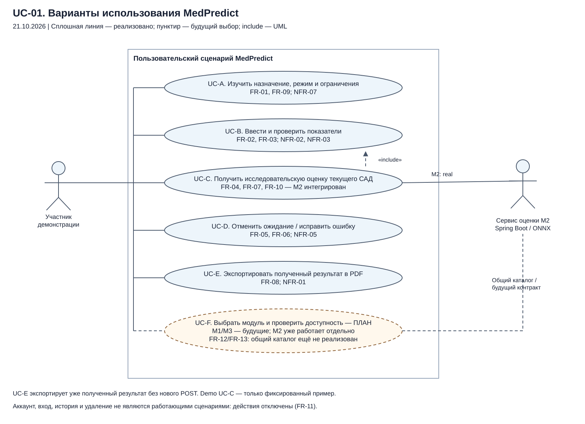
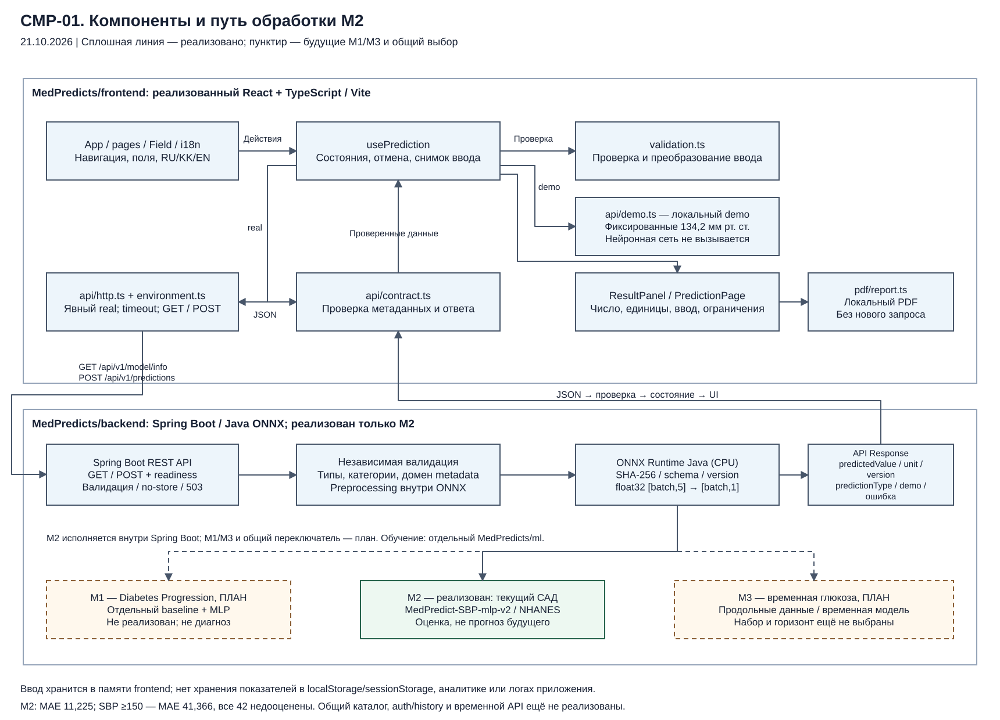

# Архитектура MedPredict

Редакция для review от 24 октября 2026 года. Основание — сохранённый локальный комплект M2 и диаграммы от **21.10.2026**. Новые запуски приложения, backend и модели при подготовке PR не выполнялись. [Исходный Word](07_Архитектура_и_диаграммы.docx) сохранён как архив предыдущей редакции.

## Границы реализации

Локальный исследовательский путь M2: **React → HTTP → Spring Boot → ONNX Runtime Java → ответ → интерфейс/PDF**. `MedPredict-SBP-mlp-v2` оценивает текущее систолическое давление по возрасту, полу, ИМТ, общему холестерину и глюкозе плазмы натощак. Это не фактическое измерение пациента и не прогноз будущего давления. Клиническая пригодность и валидация для Казахстана не установлены; по результату нельзя изменять лечение.

Отдельный demo возвращает фиксированные **134,2 мм рт. ст.** независимо от ввода. Ошибка real-режима не переключает приложение на demo. Наличие HTTP-адаптера само по себе не подтверждает работоспособность модели.

| Область | Состояние и граница |
| --- | --- |
| Frontend | React/TypeScript/Vite: форма, валидация, ожидание/отмена, защита от устаревшего ответа, RU/KK/EN, результат и PDF |
| Локальный backend/ONNX | Spring Boot, независимая валидация, исполнение M2 и MODEL_UNAVAILABLE без готового провайдера описаны сохранёнными материалами |
| Опубликованные репозитории | Текущая доступность ONNX-провайдера и bundle проверяется отдельно; PR документации не публикует этот код |
| ML | Обучение и экспорт выполняются offline; пользовательские запросы не становятся обучающими данными |
| M1/M3 в приложении | Общий выбор модулей и временной API не реализованы; offline benchmark M1 не является выпущенным модулем |
| Аккаунт и история | Недоступные страницы без завершённых серверных действий; успешный вход и сохранение не имитируются |

Ограничения эксперимента, включая крупные ошибки при высоком САД, сохранены в [сравнении систем](04_Сравнение_существующих_систем.md#2-исходная-позиция-medpredict). Техническая интеграция не доказывает научное преимущество, production-развёртывание или согласование требований.

## Диаграммы

Предоставленные схемы описывают локальный исследовательский M2 на 21.10.2026. Историческая подпись MedPredicts/ml обозначает ML-workspace; текущий репозиторий организации — [ml-ai](https://github.com/MedPredicts/ml-ai).

| ID | Содержание | Редактируемый источник | Экспорты |
| --- | --- | --- | --- |
| CTX-01 | Пользователь, браузер, API, отдельное обучение и PDF | [drawio](architecture/diagrams/context.drawio) | [SVG](architecture/diagrams/context.svg) · [PNG](architecture/diagrams/context.png) |
| UC-01 | Ввод, результат, отмена, PDF и будущий выбор модуля | [drawio](architecture/diagrams/use-cases.drawio) | [SVG](architecture/diagrams/use-cases.svg) · [PNG](architecture/diagrams/use-cases.png) |
| CMP-01 | Компоненты frontend, серверная граница и ONNX | [drawio](architecture/diagrams/components.drawio) | [SVG](architecture/diagrams/components.svg) · [PNG](architecture/diagrams/components.png) |

Файлы drawio содержат редактируемые узлы и связи. После изменения исходника нужно заново экспортировать SVG/PNG. Пунктир будущего многомодульного сценария не означает готовую функцию; UML-зависимость include обозначает обязательность проверки ввода.

## Компоненты и требования

| Компонент | Ответственность | Требования |
| --- | --- | --- |
| App, pages, components, i18n | Навигация, язык, доступные подписи и сообщения; ввод в памяти | FR-01/03/07/09/11; NFR-03/04/07 |
| usePrediction | Метаданные, один активный POST, отмена, актуальность ответа и снимок ввода | FR-02/04/05/06/07; NFR-05 |
| validation и Field | Числа, обязательность, категории и диапазоны из metadata; ошибки у полей и фокус | FR-03; NFR-02/03 |
| HTTP-адаптер | GET/POST, тайм-аут, ошибки и проверка недоверенного JSON | FR-02/04/10; NFR-02/05/08 |
| ResultPanel и PDF | Число, единица, версия конкретного ответа и ограничения; PDF без нового POST | FR-07/08; NFR-01/07 |
| Spring Boot | Независимая валидация, доступный провайдер и структурированные ошибки | FR-10/13; NFR-02/06/08 |
| ONNX M2 и offline pipeline | Признаки/предобработка, версия артефакта и численное соответствие | FR-10; NFR-06 |

Идентификаторы и критерии приёмки сохраняются в [спецификации](06_Спецификация_требований.md). Матрица описывает ответственность компонентов, а не результат нового тестового прогона.

## Контракт и последовательность

1. В real получить GET `/api/v1/model/info` и проверить схему. До корректных метаданных форма и POST недоступны; разрешён явный повтор GET.
2. Построить форму, проверить ввод и перевести фокус к первой ошибке. Диапазоны берутся только из согласованной серверной конфигурации и не называются медицинскими нормами.
3. По явному действию отправить один POST `/api/v1/predictions`; повторная отправка при ожидании блокируется.
4. Backend независимо проверяет ввод. Готовый ONNX-провайдер выполняет M2; отсутствие провайдера возвращает MODEL_UNAVAILABLE, а не демонстрационное число.
5. Клиент проверяет конечность predictedValue, единицу и необязательные поля. Версия GET не подставляется вместо отсутствующей версии POST-ответа. predictionType и demo, если присутствуют, строго проверяются; legacy demo-example остаётся маркированным demo.
6. Отмена, изменение ввода и навигация не позволяют позднему ответу восстановить устаревший результат. Отмена ожидания в браузере не доказывает остановку серверного вычисления.
7. PDF создаётся по отдельному действию из готового снимка без нового POST.

Поля M2: age, sex, bmi, totalCholesterol, glucose; лабораторные показатели — в ммоль/л, glucose означает глюкозу плазмы натощак. PR не меняет HTTP-контракт, не добавляет moduleId и не определяет временной API M3. Изменения контракта требуют согласования с Оралханом, совместных тестов и документации.

## Данные и отказоустойчивость

Frontend не сохраняет показатели в localStorage/sessionStorage, URL, аналитике или логах. Перезагрузка очищает ввод. PDF по действию пользователя остаётся отдельным файлом на устройстве. Это не обещание отсутствия копий на уровне браузера, ОС или сервера.

Demo не отправляет показатели модели; real передаёт их настроенному API. Серверные логи, доступ, TLS и хранение проверяются отдельно для конкретной среды. VITE_* видны в клиентской сборке и не подходят для секретов. База пациентов, отдельный Python HTTP inference-сервис и онлайн-дообучение не входят в текущий путь.

Состояния, тайм-аут, отмена, отсутствие автоматического повтора POST и проверка актуальности ответа ограничивают клиентские сбои. Они не подтверждают скорость сервера или доступность среды.

## Review

MED-52 связывает требования, архитектуру и README. Тексты и диаграммы передаются Оралхану (Oralkhan-coder) в PR Sanat → main. Подготовка комплекта не означает approve, merge, изменение Jira или утверждение руководителем.
