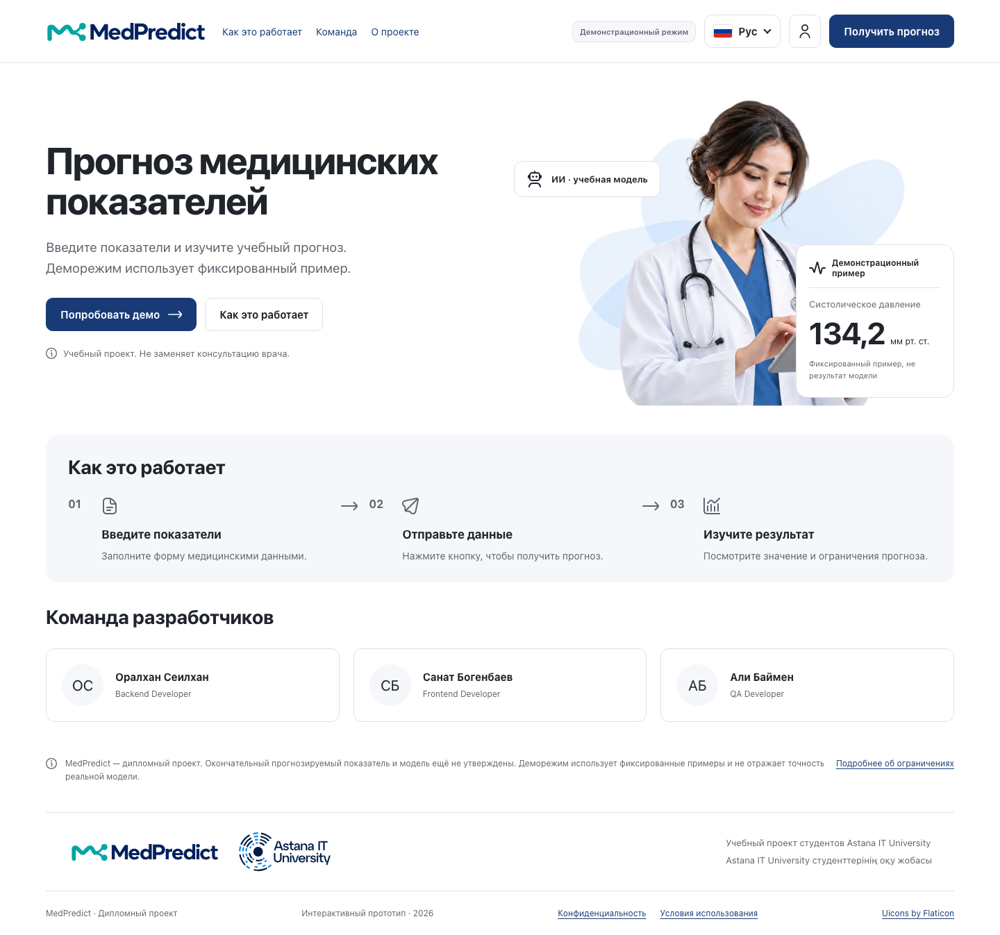
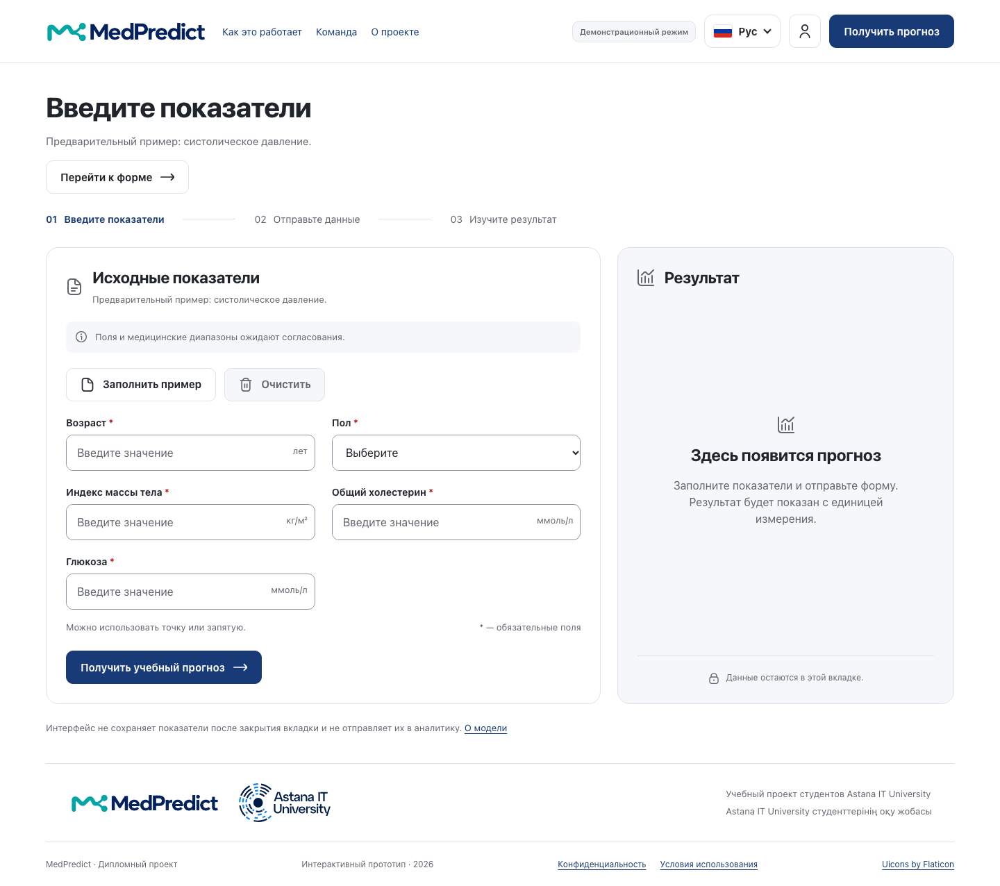
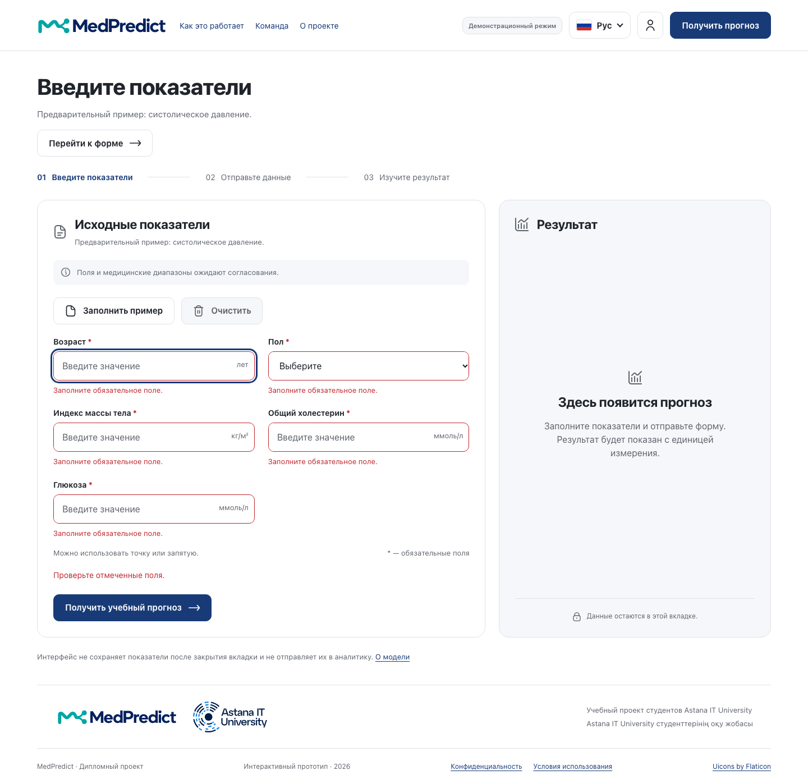
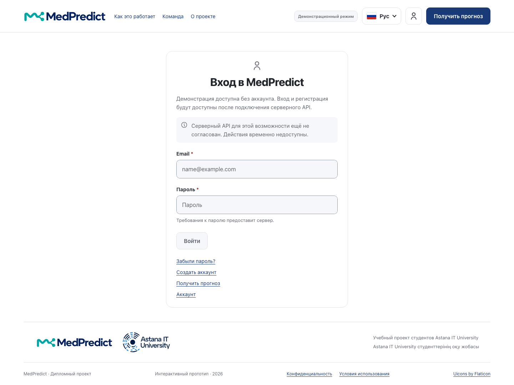
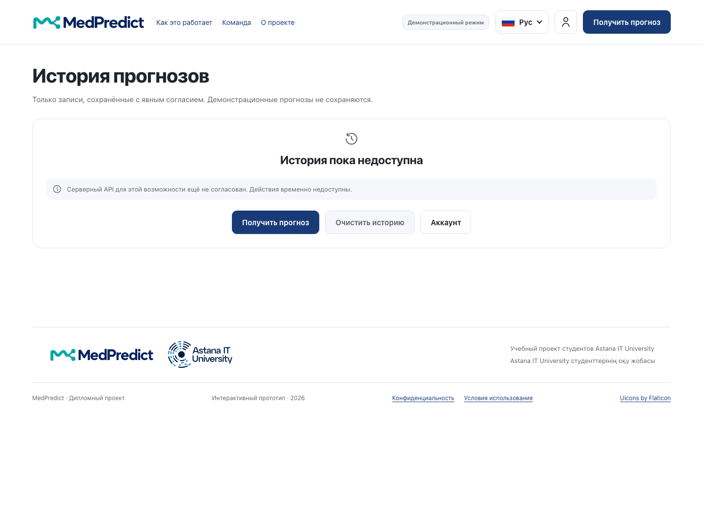
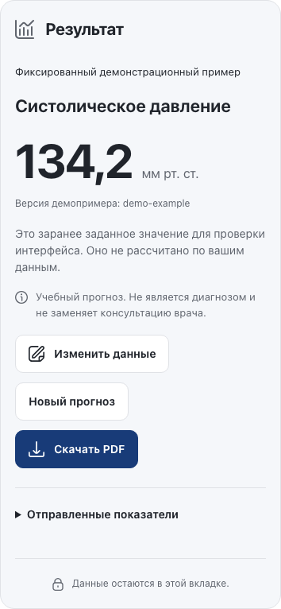
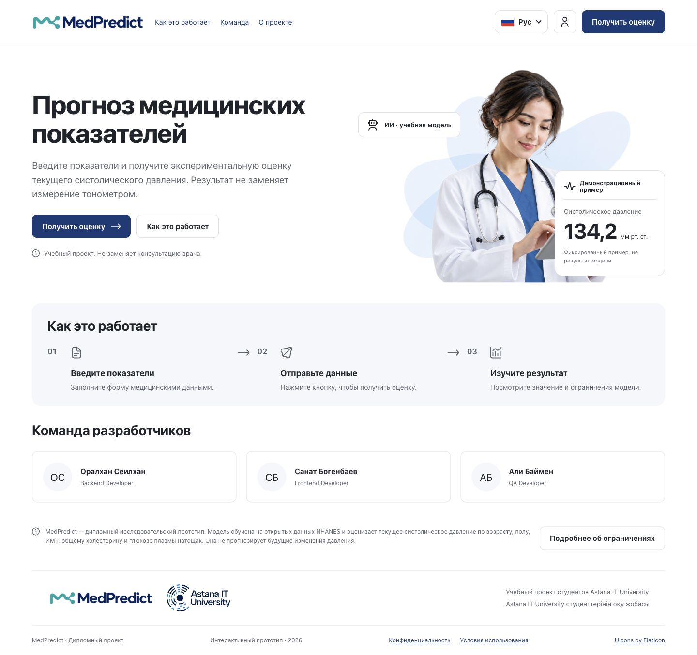
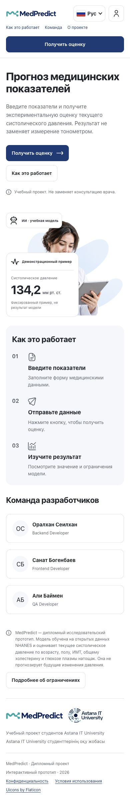

# MedPredict — UX и прототип

> Отдельный PR по **MED-13**: ветка `MED-13-prototype` → `main`, reviewer — `Oralkhan-coder`. Исходные даты материалов сохранены; новые проверки приложения не запускались.

> Русская Markdown-версия [08_UX_и_прототип.docx](08_UX_и_прототип.docx). Конвертация: 22.10.2026. Исходный Word-файл сохранён без изменений.

Экраны, ключевые сценарии, состояния форм и скриншоты работающего интерфейса

| Параметр | Сведения |
| --- | --- |
| Версия | 1.1 к первой предварительной защите 24 октября 2026 г. Материалы осмотра 16 октября; README backend добавлен 21 октября. Комплект изображений и ссылки подготовлены для review 24 октября без нового запуска приложения. |
| Границы | Скриншоты получены из расширенного прототипа (ветка figma-design, снимок d55ab67). Состояние удалённого frontend на 24 октября этим комплектом не перепроверялось. |
| Ответственный | Бөгенбаев Санат |

## 1. Назначение и источники

[Макет Figma — MedPredict / Web / scenarios](https://www.figma.com/design/zOkk0fppNrBrjWDblCDwyF/Untitled?node-id=0-1). Ссылка из исходного комплекта; права доступа и сам макет в этой правке не изменялись.

Документ описывает интерфейс на React, который реально существует в учебном проекте «Разработка интеллектуальной системы прогнозирования медицинских показателей на основе нейронных сетей». Интерфейс позволяет пользователю проверить ввод и увидеть фиксированный демонстрационный результат. Он не доказывает, что три реальные модели или backend работают.

Предоставленный макет Figma (страница 0:1, «MedPredict / Web / scenarios») содержит компоненты полей и кнопок, состояния ошибки и загрузки, сценарии входа / истории и передачу результата. Использован экспорт главного экрана (21:6, 1440 на 1405 px). Это дизайн, а не скриншот работающего frontend. Названия слоёв и наличие переходов не доказывают, что серверный API работает.

Исторический источник скриншотов от 16 октября — локальная ветка figma-design, commit d55ab67451511fe9960d867a9987709aca7e8edd, репозиторий bsanat/MedPredict. Текущий frontend команды находится в [MedPredicts/frontend](https://github.com/MedPredicts/frontend). Историческая локальная версия и текущая удалённая main не объявляются одним и тем же срезом.

Дополнительные источники: src/App.tsx, src/pages, src/components, src/hooks/usePrediction.ts, useNavigation.ts, src/styles.css, src/styles/tokens.css, docs/design/README.md, docs/api-contract.md. Изображение docs/design/concept.png в прежней документации явно является сгенерированной концепцией; здесь оно не используется как доказательство работы приложения.

## 2. Экраны и навигация

Таблица 1. Экраны расширенного прототипа

| Экран и hash-маршрут | Существующее поведение | Граница готовности |
| --- | --- | --- |
| Главная /, разделы /how, /team | Назначение, режим, три шага, команда, ссылка на форму | Потребность аудитории пока не подтверждена |
| Прогноз /predict | Форма, валидация, ожидание / отмена, результат, исправление, очистка, PDF | Демо фиксировано; HTTP-адаптеру нужен реальный сервер |
| Вход и регистрация /login, /register | Экраны с пояснением, что функция недоступна | Поля и серверные действия отключены; успешного входа нет |
| Восстановление / подтверждение | /forgot-password, /reset-password, /verify-email, /account/password | Только интерфейс; электронная почта и смена пароля не работают |
| Аккаунт /account, /account/delete | Страницы и пояснение ограничения | Активной сессии и удаления нет |
| История /history, /history/... | Состояние «недоступно» и переходы | Нет сохранённых прогнозов, загрузки или удаления записей |
| Информация /model, /limitations, /privacy, /terms | Сведения о модели / назначении и ограничениях хранения | Условия backend ещё требуют согласования |

Навигация построена на hash в URL без новой зависимости маршрутизатора. App хранит язык и форму в памяти. Переход отменяет активный запрос и скрывает результат, сохраняя введённые строки. Перезагрузка очищает ввод. Фокус переходит на заголовок целевой страницы; для разделов — на соответствующий заголовок. Эти правила нужно учитывать при демонстрации кнопки «Назад» и переходов: результат не является сохранённой историей.

## 3. Основной сценарий

Главная, «Попробовать демо», форма, ручной ввод синтетических данных или «Заполнить пример», валидация, «Получить учебный прогноз», ожидание с отменой, число / единица / ограничения, затем правка / новый прогноз или PDF.

Исходная форма пуста. Пример содержит возраст 52, пол мужской, ИМТ 27,4, общий холестерин 5,6 и глюкозу 5,9. Эти значения лишь помогают проверить интерфейс; их сочетание не описывает пациента и не подтверждает обоснованность набора признаков. В текущем демо ответ всегда 134,2 мм рт. ст. с версией demo-example.

В реальном режиме сначала загружается и проверяется GET /api/v1/model/info. Пока не получено корректное описание, POST недоступен. Подписи, единицы, категории и min / max / integer берутся из согласованных метаданных. С профилем backend по умолчанию GET отвечает 503 MODEL_UNAVAILABLE, поэтому форма корректно остаётся недоступной и предлагает повтор; demo-профиль backend отдаёт те же пять полей и фиксированное значение. Переключение между M1 / M2 / M3 и ввод временного ряда M3 не реализованы; эти экраны прототипу в документации не засчитываются.

Для реального подключения frontend нужен .env.local с VITE_API_MODE=real, VITE_API_BASE_URL=http://localhost:8080 и VITE_API_TIMEOUT_MS=15000. Если сервер работает с demo-профилем, результатом остаётся фиксированный пример.

## 4. Формы и состояния

У полей есть подписи и единицы. Число можно вводить с десятичной точкой или запятой; оно преобразуется в конечное число JSON. Проверяются обязательность, тип и категория; медицинские диапазоны используются только при наличии в конфигурации. Технически допустимое число не называется медицинской нормой.

Таблица 2. Состояния формы и запроса

| Состояние | Реализованное представление | Проверяемое правило |
| --- | --- | --- |
| Пустая / редактируемая форма | Исходные поля, подсказки, пустой результат | Результата до явной отправки нет |
| Ошибка ввода | Текст у поля, aria-invalid / aria-describedby, общий статус | Фокус переходит на первое неверное поле; исправление без потери других значений |
| Ожидание | Статус обработки, заблокированная повторная отправка, отмена | Один активный запрос; запоздавший ответ после отмены игнорируется |
| Успех в демо | 134,2, единица, пометка фиксированного примера и предупреждение | Нет утверждения, что число вычислила нейронная сеть |
| Ошибка API | Понятное сообщение, сохранённый ввод, возврат к правке | Ошибки тайм-аута / сети / сервера / контракта не маскируются успехом демо |
| Ошибка метаданных в реальном режиме | Форма недоступна, возможен повтор GET | Нет POST без корректной схемы |
| Очистка | ConfirmDialog, отмена и подтверждение | Отмена сохраняет значения и возвращает фокус |
| Экспорт PDF | Подготовка, заблокированный повторный клик, ошибка / повтор | Использует готовый снимок запроса и ответа, без нового POST |

Ошибки API и PDF описаны по исходникам и существующим тестам. Демо и клиентская валидация проверялись; реальный сервер и все негативные ветви заново не запускались.

## 5. Результат и прозрачность

Результат показывает число и единицу, версию ответа, когда она приходит, предупреждение и раскрываемый снимок отправленных значений. Версия из метаданных не подставляется вместо отсутствующей версии конкретного ответа. После правки результат скрывается. Доверительный интервал, график глюкозы, диагноз и рекомендации по лечению не реализованы и не заявляются.

Экспортированный PDF содержит учебное предупреждение и пометку демо, когда режим демонстрационный. Дата документа не называется временем прогноза: в текущем контракте такого времени нет. Файл пользователь скачивает сам, и он содержит введённые им показатели. Прежние проверки описаны в docs/verification.md.

## 6. Адаптивность и доступность

По стилям на узких экранах рабочие панели становятся одной колонкой, затем поля располагаются вертикально. Есть ссылка пропуска навигации, видимый фокус, доступные подписи, статус результата, перенос фокуса на успех и поддержка prefers-reduced-motion. Клиентские тексты и демо доступны на русском, казахском и английском языках. Произвольные серверные подписи автоматически переведёнными не считаются; backend локализует собственные сообщения об ошибках по Accept-Language, который frontend пока не отправляет.

Проверка в Chromium выявила отсутствие горизонтального переполнения при 1440 на 1050 и 390 на 844 в изученных состояниях. Она не удостоверяет полное соответствие WCAG, контрастность каждого компонента, работу скринридера, Safari / Firefox или физические устройства. Результаты прежних проверок при 320 px и на трёх языках хранятся отдельно в docs/verification.md.

## 7. Приватность и учебные ограничения

Показатели не сохраняются в localStorage / sessionStorage, URL, аналитике или журналах frontend. Демо не отправляет показатели на сервер. В реальном режиме данные уходят на настроенный API; журналы сервера, хранение и удаление согласуются и проверяются отдельно (README backend сообщает, что у него нет базы данных и тела запросов не журналируются). Память вкладки и добровольный PDF не равны обещанию, что копий нет на устройстве пользователя.

Пользователь должен понимать, что система учебная, демо фиксировано, результат не является диагнозом и не заменяет консультацию специалиста. Три будущих модуля различаются по смыслу: M1 — числовая шкала прогрессирования; M2 — оценка измеренного систолического АД; M3 — будущая точка ряда на утверждённом горизонте. Единый внешний вид не позволяет объединять эти значения в клинический вывод.

## 8. Скриншоты работающего приложения

Ниже приложены существующие скриншоты локального приложения от 16 октября 2026 г.; использованы только синтетические примеры. Новый запуск для этого PR не выполнялся. Скриншоты рабочего стола использовали окно 1440 на 1050, мобильные — 390 на 844; язык интерфейса — русский. Скриншоты не являются результатом исследования пользователей.

Рисунок 1. Главная страница с пометкой демо и учебным назначением.

Рисунок 2. Пустая форма и отсутствие результата до отправки.

Рисунок 3. Пять ошибок обязательных полей после отправки; фокус на возрасте.

Рисунок 4. Фиксированные 134,2 мм рт. ст., пометка демо и действия с результатом.

Рисунок 5. Экран входа; серверные действия временно недоступны.

Рисунок 6. История не имитирует сохранённые результаты.

Рисунок 7. Панель результата в мобильном окне 390 на 844.

[Полный мобильный экран с формой и результатом](ux/screenshots/07-prediction-mobile.png) сохранён отдельно от укрупнённой панели рисунка 7.

### Лендинг от 21 октября 2026 года

Рисунок 8. Существующий локальный лендинг, desktop 1440 px. Карточка 134,2 показывает фиксированную иллюстрацию, а не результат M2.

Рисунок 9. Тот же лендинг, mobile 390 px. Оба снимка используют синтетические примеры; работа ONNX и пользовательская полезность ими не подтверждаются.

## 9. Протокол осмотра и отличия от макета

Пройден путь: главная, форма, пустая отправка, пять ошибок, пример, фиксированный результат. Затем открыты отключённые вход и история, а результат повторён в мобильном размере. Программно проверены: заголовок страницы, непустой H1, отсутствие оверлея Vite, отсутствие ошибок / предупреждений в консоли, отсутствие переполнения, отсутствие POST и записей в веб-хранилище в этом демо-проходе. Это ограниченная проверка для фиксации прототипа.

Осмотр Figma подтверждает визуальные материалы и задуманные сценарии, включая auth / history, которые пока не работают. В макете карточка Али подписана QA Developer, тогда как текущее распределение в команде делает его ответственным за наборы данных и ML. В документах используется текущая роль; макет не редактировался. Состояния успешной авторизации и истории в макете не повышают статус их реализации. Заметка в Figma о том, что для реального режима нужен вход, также не создаёт согласованного контракта аутентификации.

Готовность UX как прототипа подтверждена артефактами и локальной демонстрацией. Понятность для реальных пользователей остаётся PENDING до исследования по отдельному плану. Перед защитой Санату следует проверить, что комиссия может открыть Figma и репозиторий, и отрепетировать честное объяснение, чем демо отличается от модели.
