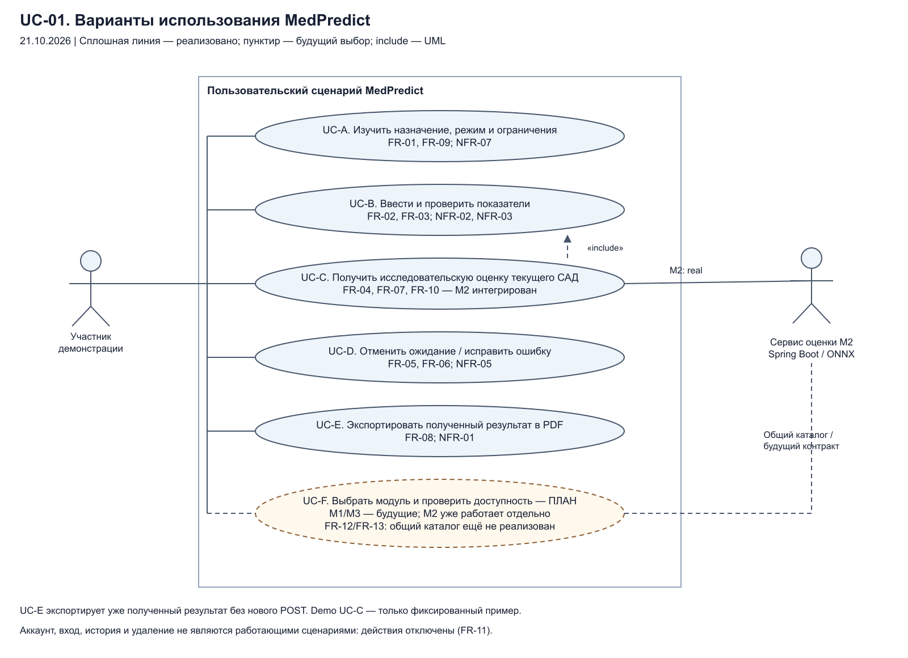
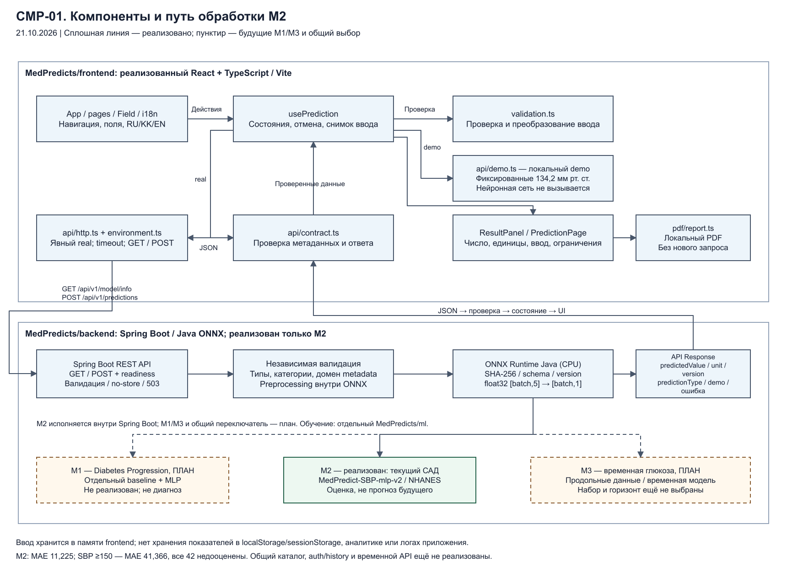

# Документация MedPredict

## 1. Проект и краткое описание

**MedPredict** — учебный исследовательский прототип для оценки и прогнозирования числовых медицинских показателей с помощью нейронных сетей и сравнения с базовыми методами. Тема диплома: «Разработка интеллектуальной системы прогнозирования медицинских показателей на основе нейронных сетей». Этот репозиторий содержит проектную документацию, интервью, архитектурные схемы и итоговый отчёт; код приложения размещён отдельно.

Материалы дипломного проекта Astana IT University, Software Engineering, SE-2409. Первая предварительная защита — **24 октября 2026 года**. Навигация обновлена 24.10.2026; опубликованные Markdown-документы перенесены и частично актуализированы 22.10.2026. Исходные Word-файлы сохранены и могут описывать более раннее состояние.

Этот комплект объединяет навигацию по документам, три интервью, редактируемые диаграммы и итоговый отчёт. Ссылки на Markdown ведут в ветку `main` репозитория документации; изображения, исходники диаграмм и отчёт доступны по относительным путям внутри репозитория.

Содержание README: [1. Проект](#1-проект-и-краткое-описание) · [2. Проблема и результат](#2-проблема-пользователи-и-ожидаемые-результаты) · [3. Команда](#3-команда-и-научный-руководитель) · [4. Статус](#4-текущее-состояние-и-ограничения) · [5. Стек](#5-выбранный-технологический-стек) · [6. Ссылки и документы](#6-ссылки-документы-и-материалы) · [7. Запуск и проверки](#7-установка-запуск-и-проверки).

## 2. Проблема, пользователи и ожидаемые результаты

Медицинский показатель, вероятность заболевания и прогноз будущего значения решают разные задачи. При переносе модели из исследовательской среды в веб-приложение также могут измениться порядок признаков, единицы, предобработка и смысл ответа. MedPredict исследует воспроизводимый путь от данных и сравнения моделей до проверенного API, понятного результата и локального PDF. Записи интервью дополнительно описывают разрозненность учебной информации и потребность в пояснениях; они не доказывают клиническую полезность продукта.

**Целевые пользователи текущего этапа:** студенты, исследователи и участники контролируемой учебной демонстрации. Пациенты и самостоятельное принятие решений о лечении не являются подтверждённым сценарием применения.

**Ожидаемые результаты:**

- Зафиксированные данные, целевой показатель и протокол сравнения базовых методов с нейросетью, включая отрицательные результаты и ограничения.
- Версионированный исследовательский артефакт и проверенная локальная передача результата через API без изменения единиц и предобработки.
- Интерфейс ввода, ошибок и результата с явным разделением demo и модели, локальным PDF и доступными комиссии документами.

## 3. Команда и научный руководитель

| Участник | Ответственность |
| --- | --- |
| **Бөгенбаев Санат** | Frontend и UI/UX: React/TypeScript/Vite, форма и состояния, доступность, локализация, HTTP-адаптер, PDF и материалы прототипа. |
| **Баймен Али** | Данные и ML: интервью, литература, паспорта данных, базовые методы и нейросети, оценка ошибок, воспроизводимость и модельные артефакты. |
| **Сеилхан Оралхан** | Backend и интеграция: Java/Spring Boot, REST-контракт, серверная валидация, исполнение модели, численное соответствие и интеграционные проверки. |

**Научный руководитель: Турарова Маржан Кабдыкалиевна.** ФИО и распределение ролей приведены по предоставленному [плану проекта](https://github.com/MedPredicts/documentation/blob/main/12_План_работы_над_дипломным_проектом_MedPredict_RU.md). Указание руководителя не означает полученного отзыва или одобрения; [журнал рассмотрения](https://github.com/MedPredicts/documentation/blob/main/11_Журнал_отзывов_руководителя.md) остаётся PENDING до подлинного подтверждения. Роли сами по себе не заменяют свидетельства личного вклада.

## 4. Текущее состояние и ограничения

По переданному рабочему дереву и сохранённым отчётам локально интегрирован **M2 — экспериментальная оценка текущего систолического давления** по возрасту, полу, ИМТ, общему холестерину и глюкозе плазмы натощак. Путь — React → Spring Boot → ONNX, модель `MedPredict-SBP-mlp-v2`. Это не фактическое измерение пациента, не прогноз будущего давления и не диагноз.

| Граница | Состояние на 24.10.2026 |
| --- | --- |
| Опубликованный frontend | Форма, проверки, ошибки и отмена, RU/KK/EN, адаптивность, PDF, автономный фиксированный demo и HTTP-адаптер. |
| Опубликованный backend | REST-контракт и валидация; по умолчанию `503 MODEL_UNAVAILABLE`, в профиле `demo` фиксированные 134,2 мм рт. ст. ONNX-провайдера в этом опубликованном коде нет. |
| Локальная интеграция M2 | Обученная модель и Java ONNX существуют в отдельном локальном комплекте; текущие удалённые исходники не воспроизводят его целиком. |
| Публикация `ml-ai` | README и архитектурные материалы; исполняемый Python-код, зависимости, веса, ONNX bundle и протоколы экспериментов не опубликованы. |
| M1 и M3 | Локальный offline benchmark M1 выполнен 23.10.2026; формы, API и ONNX-релиза M1 нет. Аудит CGMacros для M3 имеет статус **NO_GO** для исходной задачи causal forecasting; модель M3 не обучена. Эти исследовательские работы описаны в [ML-AI README](https://github.com/MedPredicts/ml-ai#readme) отдельно от работающего приложения. |
| Аккаунт и история | Регистрация, вход и сохраняемая история — недоступные макеты без завершённых серверных сценариев. |

Сохранённая внутренняя weighted MAE M2 — **11,225 мм рт. ст.**; при истинном САД ≥150 все 42 test-случая занижены, MAE группы — **41,366 мм рт. ст.** Устойчивое преимущество над Ridge, клиническая пригодность и применимость к Казахстану не установлены. Это прежние результаты локального эксперимента, а не новые испытания при обновлении README. Серверные тексты могут быть локализованы не полностью. История, импорт, устройства и кабинет врача из анализа аналогов являются предложениями.

## 5. Выбранный технологический стек

| Часть | Выбор и назначение |
| --- | --- |
| Frontend | **React + TypeScript + Vite**; форма, состояния запросов, проверка внешнего JSON и локальный PDF через jsPDF. Проверки: Vitest, ESLint, TypeScript и Playwright. |
| Backend | **Java 17 + Spring Boot 3.5**, Maven Wrapper, Jakarta Bean Validation и springdoc/OpenAPI; проверка запроса и REST-граница. |
| Локальное ML-исследование | **Python, PyTorch, scikit-learn**, NHANES, сравнение baseline/MLP и экспорт предобработки с моделью в **ONNX**; в отдельном локальном серверном комплекте — ONNX Runtime Java. Эта строка описывает локальную работу, а не опубликованный пакет для установки. |

Для текущего сценария база данных, сохранение показателей и отдельный Python HTTP inference-сервис не используются. Запросы пользователей не становятся обучающей выборкой. Обоснование альтернатив приведено в [сравнении технологий](https://github.com/MedPredicts/documentation/blob/main/05_Сравнение_технологий.md); исторические статусы в нём нужно сверять с таблицей выше.

## 6. Ссылки, документы и материалы

**Прямые ссылки:** [Jira MED, доска 2](https://medpredict.atlassian.net/jira/software/projects/MED/boards/2) · [документация проекта](https://github.com/MedPredicts/documentation#readme) · [frontend](https://github.com/MedPredicts/frontend#readme) · [backend](https://github.com/MedPredicts/backend#readme) · [ML-AI](https://github.com/MedPredicts/ml-ai#readme) · [Figma](https://www.figma.com/design/zOkk0fppNrBrjWDblCDwyF/Untitled?node-id=0-1).

Для комиссии: [документы](#документы-для-комиссии) · [три интервью](#три-интервью) · [три редактируемые диаграммы](#три-редактируемые-диаграммы) · [отчёт](#дипломный-отчёт).

### Документы для комиссии

| № | Раздел | Материал и статус |
| --- | --- | --- |
| 01 | Предложение проекта | [Markdown](https://github.com/MedPredicts/documentation/blob/main/01_Предложение_проекта.md) · [исходный Word](01_Предложение_проекта.docx). Постановка, реализованный M2 и границы проекта. |
| 02 | Исследование пользователей | [Три заполненные записи интервью](#три-интервью) · [полный протокол](https://github.com/MedPredicts/documentation/blob/main/02_Интервью.md) · [Word](02_Интервью.docx). Записи не являются клинической валидацией. |
| 03 | Обзор литературы | [Markdown](https://github.com/MedPredicts/documentation/blob/main/03_Обзор_литературы.md) · [Word](03_Обзор_литературы.docx). Перенос исходного обзора; эта правка не является новой проверкой всех публикаций. |
| 04 | Существующие системы | [Markdown](https://github.com/MedPredicts/documentation/blob/main/04_Сравнение_существующих_систем.md) · [Word](04_Сравнение_существующих_систем.docx). Казахстанские и международные ориентиры, источники и приоритеты развития. |
| 05 | Технологии | [Markdown](https://github.com/MedPredicts/documentation/blob/main/05_Сравнение_технологий.md) · [Word](05_Сравнение_технологий.docx). Исторические статусы моделей и интеграции внутри документа требуют сверки с текущим состоянием. |
| 06 | Спецификация требований | [Markdown](https://github.com/MedPredicts/documentation/blob/main/06_Спецификация_требований.md) · [Word](06_Спецификация_требований.docx). Функциональные требования, ограничения и предложения. |
| 07 | Архитектура | [Три диаграммы с исходниками](#три-редактируемые-диаграммы) · [исторический текст](https://github.com/MedPredicts/documentation/blob/main/07_Архитектура_и_диаграммы.md) · [Word](07_Архитектура_и_диаграммы.docx). Старый текст не отражает все последующие изменения M2. |
| 08 | UX и прототип | [Markdown](https://github.com/MedPredicts/documentation/blob/main/08_UX_и_прототип.md) · [Word](08_UX_и_прототип.docx) · [Figma](https://www.figma.com/design/zOkk0fppNrBrjWDblCDwyF/Untitled?node-id=0-1). Макеты и их переходы не доказывают реализацию серверных функций. |
| 09 | Проверка и оценка | [Markdown](https://github.com/MedPredicts/documentation/blob/main/09_План_тестирования_и_оценки.md) · [Word](09_План_тестирования_и_оценки.docx). Сохранённые результаты отделены от планов независимой и пользовательской оценки. |
| 10 | Управление и риски | [Markdown](https://github.com/MedPredicts/documentation/blob/main/10_Управление_проектом_и_риски.md) · [Word](10_Управление_проектом_и_риски.docx) · [сверка Jira от 22.10.2026](https://github.com/MedPredicts/documentation/blob/main/Jira_сверка_2026-10-22.md). |
| 11 | Отзыв руководителя | [Журнал / шаблон](https://github.com/MedPredicts/documentation/blob/main/11_Журнал_отзывов_руководителя.md) · [Word](11_Журнал_отзывов_руководителя.docx). **PENDING:** подлинный отзыв и факт рассмотрения не предоставлены; шаблон не является одобрением. |
| 12 | План дипломного проекта | [Markdown](https://github.com/MedPredicts/documentation/blob/main/12_План_работы_над_дипломным_проектом_MedPredict_RU.md) · [Word на GitHub](https://github.com/MedPredicts/documentation/blob/main/12_План_работы_над_дипломным_проектом_MedPredict_RU.docx). Читать вместе со сверкой Jira и фактическим состоянием реализации. |
| — | Дипломный отчёт | [Word](report/MedPredict_Project_Report_24_October_2026.docx) · [PDF](report/MedPredict_Project_Report_24_October_2026.pdf) · [состав комплекта](#дипломный-отчёт). |

Текущий трекер — [Jira MED, доска 2](https://medpredict.atlassian.net/jira/software/projects/MED/boards/2). YouTrack/PLAN/PD1 в старых документах относятся к истории; их номера нельзя автоматически переносить в Jira.

### Три интервью

В опубликованном [документе 02](https://github.com/MedPredicts/documentation/blob/main/02_Интервью.md) находятся **три отдельные расшифровки в одном файле**, а не три файла:

1. [Ислам Мухамеджан — раздел 3](https://github.com/MedPredicts/documentation/blob/main/02_Интервью.md#3-расшифровка-ислам-мухамеджан), студент 3 курса медицинского университета.
2. [Бакытбек Кайырбек — раздел 4 «Кайырбек Бакытбек»](https://github.com/MedPredicts/documentation/blob/main/02_Интервью.md#4-расшифровка-кайырбек-бакытбек), студент 4 курса медицинского университета.
3. [Ерасыл Кушекбаев — раздел 5](https://github.com/MedPredicts/documentation/blob/main/02_Интервью.md#5-расшифровка-ерасыл-кушекбаев), стажёр-медбрат областной больницы.

В источнике указаны дата **21.10.2026**, интервьюер **Баймен Али**, личная текстовая переписка и отсутствие записи, с согласием только на транскрипт. Здесь проверено наличие опубликованных текстов и соответствующих разделов. Личность участников, исходная переписка, согласие на публичное распространение и подтверждение расшифровок независимо не проверялись. Ответы не переписаны и не дополнены. Синтетические интервью из других рабочих материалов к этим трём записям не относятся.

### Три редактируемые диаграммы

Схемы описывают **локально интегрированную исследовательскую M2**, отдельный фиксированный demo и будущие модули приложения M1/M3. Они не подтверждают готовность текущей опубликованной ветки backend, production-развёртывание или клиническую пригодность. Сохранена дата исходников 21.10.2026; последующий offline benchmark M1 не превращает его в подключённый модуль. Историческая подпись `MedPredicts/ml` внутри схем обозначает отдельный ML-workspace; текущий репозиторий организации называется [ml-ai](https://github.com/MedPredicts/ml-ai).

Каждый `.drawio` содержит отдельные узлы, связи и подписи для редактирования в diagrams.net. SVG и PNG — представления того же исходника. После изменения `.drawio` нужно обновить оба экспорта и проверить подписи.

#### Контекст CTX-01

[](architecture/diagrams/context.png)

[Редактируемый Draw.io](architecture/diagrams/context.drawio) · [SVG](architecture/diagrams/context.svg) · [PNG](architecture/diagrams/context.png).

#### Варианты использования UC-01

[](architecture/diagrams/use-cases.png)

[Редактируемый Draw.io](architecture/diagrams/use-cases.drawio) · [SVG](architecture/diagrams/use-cases.svg) · [PNG](architecture/diagrams/use-cases.png).

#### Компоненты CMP-01

[](architecture/diagrams/components.png)

[Редактируемый Draw.io](architecture/diagrams/components.drawio) · [SVG](architecture/diagrams/components.svg) · [PNG](architecture/diagrams/components.png).

Прежние изображения в корне репозитория сохранены; новые ссылки ведут в `architecture/diagrams/`.

### Дипломный отчёт

Итоговый комплект для предзащиты 24 октября 2026 года: [редактируемый отчёт Word](report/MedPredict_Project_Report_24_October_2026.docx) и [PDF для чтения и печати](report/MedPredict_Project_Report_24_October_2026.pdf). В `report/` находятся проверенные финальные копии. Документы 01–12 — самостоятельные исходные материалы; их наличие не означает, что Word-версии синхронизированы с итоговым отчётом.

Репозитории: [frontend](https://github.com/MedPredicts/frontend), [backend](https://github.com/MedPredicts/backend), [ml-ai](https://github.com/MedPredicts/ml-ai), [documentation](https://github.com/MedPredicts/documentation), [App-IOS](https://github.com/MedPredicts/App-IOS). Название App-IOS само по себе не подтверждает готовое нативное приложение. Наличие репозиториев и диаграмм не заменяет проверку конкретной версии, приёмку командой и решение о едином комплекте сдачи.

Для содержательного чтения начать с 01/04, затем сверить 06/09/10. Исторические статусы 03/05/07/08 и план 12 учитывать отдельно. Шаблон отзыва руководителя и исходные документы не изменены.

## 7. Установка, запуск и проверки

Репозиторий `documentation` не содержит исполняемого приложения: Markdown и схемы открываются в браузере, DOCX/PDF — в совместимом просмотрщике. Ниже — краткий запуск **опубликованного фиксированного demo**, а не локальной обученной M2. Нужны Git, **Node.js 22.12+ и npm** для frontend, **JDK 17+** для backend и доступ к сети для загрузки зависимостей. Команды ниже предназначены для macOS/Linux; варианты для Windows и настройки перечислены в [README backend](https://github.com/MedPredicts/backend#readme).

В первом терминале запустить backend с явно выбранным профилем demo:

```sh
git clone https://github.com/MedPredicts/backend.git
cd backend
sh ./mvnw spring-boot:run -Dspring-boot.run.profiles=demo
```

Во втором терминале, из общей рабочей папки, установить и запустить frontend:

```sh
git clone https://github.com/MedPredicts/frontend.git
cd frontend
npm ci
npm run dev
```

Открыть [http://127.0.0.1:5173](http://127.0.0.1:5173). Vite направляет `/api` на backend `http://127.0.0.1:8080`; [Swagger UI](http://127.0.0.1:8080/swagger-ui/index.html) описывает HTTP-контракт. Ответ этого профиля — фиксированные **134,2 мм рт. ст.**, `demo-example`, независимо от синтетического ввода. Без backend можно вместо `npm run dev` выполнить `npm run dev:demo`: это автономный фиксированный пример. Запуск backend без профиля demo возвращает `503 MODEL_UNAVAILABLE`, а не обученный результат.

Проверки из каталога `frontend`:

```sh
npm run typecheck
npm run lint
npm test
npm run build
```

Проверка из каталога `backend`:

```sh
sh ./mvnw test
```

Расширенные браузерные и интеграционные команды приведены в [README frontend](https://github.com/MedPredicts/frontend#readme). Проверке настоящего M2 требуется отдельно предоставленный совместимый серверный snapshot и ONNX bundle; опубликованного backend для неё недостаточно. Для `ml-ai` команды установки и обучения не приводятся: исполняемый код и зависимости не опубликованы, поэтому клонирование репозитория не создаёт ML-среду.

При этой правке README проверены опубликованные команды и ссылки, состав файлов и редактируемые источники. Установка зависимостей, приложение, backend, обучение и повторные интервью заново не запускались.
